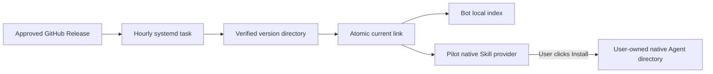

# Skill runtime delivery

The release maintainer remains the content owner. One native systemd timer
per consuming host downloads the stable GitHub Release, verifies its checksum,
complete file manifest and public-document index, and atomically replaces
`/var/lib/sai-skills/current`. Consumers validate fixed local version directories.
An unavailable source, invalid package, modified local tree, conflicting
version or downgrade leaves the previous version selected. There is no model
call, question-path download or new service process.



Build the reproducible, standard-library-only runtime with Python 3.10 or later:

```sh
python3 skill_package.py runtime --output dist/sai-skill-package.pyz
```

Deploy that exact artifact at
`/usr/local/lib/sai-skills/sai-skill-package.pyz` (root-owned, mode 0644),
alongside these two unit files in `/etc/systemd/system`. The consuming host
needs Python 3.10+, a system CA bundle and outbound HTTPS to GitHub
and its release assets, or the existing SAI public documentation site when the
primary transport is unavailable. Version discovery uses GitHub's native stable-release
redirect, without API credentials or anonymous API quota. No exporter
dependencies or credentials are required.
The service's only writable persistent directory is its native StateDirectory.

GitHub remains the primary release source. Only a transport error or timeout
selects the fixed official fallback at
`https://www.open-sai.com/docs/skills/release.json`. That small static JSON
contains `name`, stable `version`, `sha256`, the original GitHub `release` URL
and a basename such as `sai-user-guide-v0.3.1.zip`. The updater validates every
field and downloads that basename from the same fixed directory. The public
documentation builder publishes the exact same released ZIP; no new service,
credentials, global DNS change or alternate content owner is introduced.

Primary discovery and transfer share a 60-second budget, leaving the rest of
the existing 180-second update deadline for the fallback. Individual network
operations have at most a 20-second timeout, bounded by their remaining budget;
the native service also retains its four-minute execution limit. If primary
metadata was already read, the fallback must identify that exact version and
SHA. Bad hashes, invalid metadata, same-version conflicts and downgrades fail
without switching to another source. The installed receipt still identifies
the GitHub release and SHA; `status.json` and `current` report the successful
delivery `source` as `github` or `sai`.

Before the first migration, compare the candidate public document IDs against
the existing consumer manifest and review every removal. This is a release
preflight; do not maintain another permanent corpus list. Then run the service
once, read back the package and consumer behavior, and enable the timer:

```sh
systemctl daemon-reload
systemctl start sai-skills-update.service
python3 /usr/local/lib/sai-skills/sai-skill-package.pyz current --store /var/lib/sai-skills --require-index
systemctl enable --now sai-skills-update.timer
```

Enable both consumers only with the same qualified content release. The Bot
points its existing knowledge plugin at
`/var/lib/sai-skills/current/sai-user-guide/references`; Pilot's native provider
uses the fixed path returned by `current`. Their existing reload mechanisms
verify new content before publishing it to a request. The old 0.2.3 package
has no public-document index and is intentionally refused by `--require-index`.

`current` returns the installed version, fixed path, release URL, archive
SHA-256 and latest update attempt. Failures are visible in `status.json`, the
command's nonzero JSON result and `journalctl -u sai-skills-update.service`.
The timer checks once an hour, with up to five minutes of jitter, including
missed runs after reboot. A failed check is retried at the next timer event.

The writer holds `.download.lock` during download, leaving the installed
version readable even when the release server is slow or unavailable.
Publication and cleanup take a separate, short exclusive `.update.lock`.
The Bot acquires its shared side only while constructing a new in-memory index.
Pilot uses `current --hold`: one compact JSON line is flushed while the shared
lock stays held, then stdin acknowledgment or EOF releases it (60-second bound).
It loads the native Skill inside this scope, caches the result, and exposes the
stable `current` path for later references. Old conversation text remains a
historical snapshot; later reference reads use the current published documents.
Ordinary unchanged reads do not revalidate the package or download anything.

After successful activation, package verification and receipt publication,
cleanup retains the current and previous version. It removes only older,
unchanged generated directories whose release and file hashes still match.
An active consumer load or user copy holds the shared lock, so cleanup cannot
remove its input. Modified or unknown directories are retained with their paths
in the result. This is content-based retention, not deletion by age.

Pilot's one-click action calls `install-user --store /var/lib/sai-skills
--agent codex|opencode|claude`; `--dry-run` returns the exact target first.
The tool rejects root and obtains the real effective UID's home from NSS,
not browser input or `$HOME`. Codex and OpenCode use `~/.agents/skills`;
Claude Code uses `~/.claude/skills`. This installs a personal copy, with no
background writer. Repeating the action updates an unchanged managed copy;
local modifications are preserved and reported as `LOCAL_MODIFIED`. A native
file lock serializes concurrent installs. Backups retain original inodes at
`~/.local/share/sai-skill-backups`, outside discovery directories.
Earlier unchanged packages in `~/.codex/skills` and
`~/.config/opencode/skills` are moved into that same backup during installation,
so the new shared copy does not leave stale duplicates in native discovery.
Personal or unrecognized old copies are preserved and reported with their path.
SIGTERM enters normal rollback; after a hard process or host failure, inspect the
target and retained backup before retrying. Requests that lose their reply
must read back before being reported as completed.

Personal copies are portable across the user's shared home; they do not link
to a host-local `/var/lib` path that may be missing on another login or compute
node. A normal sequence of explicit upgrades keeps each native destination's
current copy and its most recent backup. Codex and OpenCode share one
destination; Claude's separate copy keeps its own rollback. The installer's
own `~/.local/state/sai-skills/installed.json`
receipt records only verified release origins for those copies. Older backups
may be collected only when their original receipt and complete file hashes
still match. User edits, unknown provenance and observed open editor handles
are retained and listed, including after reopening the settings page. Before
deleting an eligible backup, the installer renames it and checks the same
inodes again. Process-handle checks cover descriptors visible on the current
host; they are not a claim to inspect hidden namespaces or other hosts.
The native OS and existing home isolation retain ownership of that boundary.

To stop automatic updates, disable `sai-skills-update.timer`. Existing local
packages remain readable. To roll back content, stop the timer, verify the
chosen retained version with `check`, and atomically replace `current` using
the host's native symlink/rename commands. Read back both consumers; preserve
the old release directories until that readback passes. A same-version asset
replacement is rejected, so publish a new version for a content correction.
Personal copies belong to their users and are not rolled back by this action.

Validation in this repository covers local package transitions, failures,
ownership checks and CLI serialization. It does not establish a production
deployment or an authenticated Pilot browser installation.
