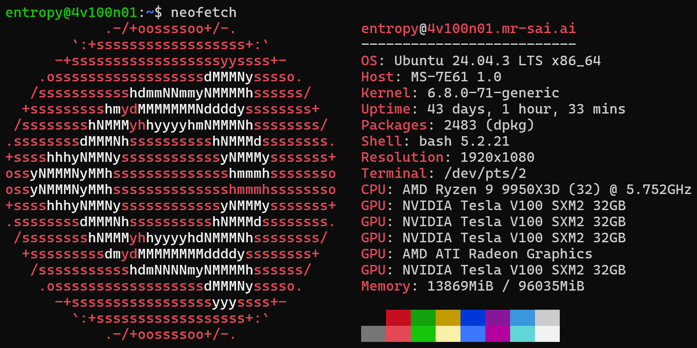
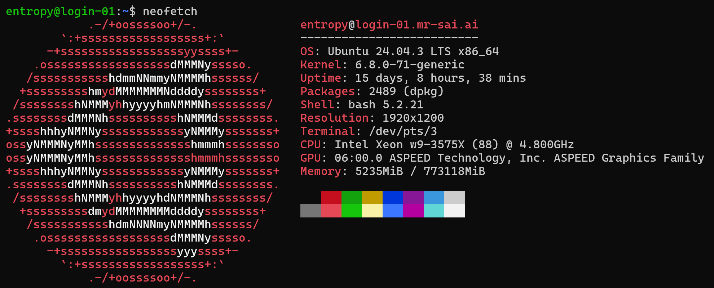

# 快速开始

> - 第一次使用，请先完成[5分钟上手](../df8c6d77197060d17cc2d0d2/index.md)。本页用于查概念、QOS 和常用命令；完整目录在左上角“≡”。
> - 请**<u>仔细阅读登录提示</u>**，对于有Slurm调度集群使用基础的用户，通过登录提示即可完成计算任务提交
> - SAI唯一指定用户交流群：1059719323
> - 技术问题请发到用户群，附任务 ID、报错原文和相关脚本片段，便于共同排查。

## 基本概念

> SAI 使用 Slurm 分配计算资源。提交任务后，程序在分配到的计算节点上运行。

下面的术语在提交脚本和任务状态中会反复出现，可按需查阅：

- **计算集群**\
  多台服务器共同提供资源；每台服务器称为一个节点。调度器按任务申请分配节点。
- **共享存储**\
  让多个节点访问同一份文件。共享不等于备份；重要数据仍需自行备份，目录用途见[存储空间](../440de28fe59b369e89df5e1c/index.md)。
- **并行计算**\
  程序需要支持 MPI、多线程或多 GPU 才能利用相应资源。Slurm 分配资源，不会自动把串行程序拆成并行程序。
- **GPU 加速**\
  需要使用支持 GPU 的软件和版本。收益取决于程序、数据规模与通信开销，先用小规模任务测试。
- **高速互联**\
  InfiniBand、NVLink 等用于节点间或 GPU 间通信。实际性能取决于拓扑及程序如何通信。
- **登录节点 vs 计算节点**
  - **登录节点**：仅用于上传/下载数据、编辑文件、提交/管理任务、安装软件，禁止在登录节点运行计算任务。
  - **计算节点**：执行任务的服务器；所有计算须在调度系统分配的资源内运行。
- **计算节点分区（Partition）**\
  一组计算节点的集合，分隔不同类型的计算节点以适配不同的计算需求。
- **任务（Job）**\
  提交计算的基本单元。
- **任务调度系统**\
  超算资源由多人共享，不能像单机一样“随时运行”。您需通过任务脚本或专用的交互式命令提交任务（如指定需要多少CPU/GPU、内存等），系统按队列排队调度。常见调度器：Slurm、PBS、LSF。
- **QOS（Quality of Service）**\
  用于控制任务的类型、优先级、资源配置等，确保任务调度符合用户需求。
- **软件环境管理**\
  超算通常用Environment Modules管理软件（如`module load gcc/15.2.0`），避免版本冲突。
- **I/O（输入/输出）**\
  大量小文件和频繁读写会拖慢任务，也可能影响其他用户。临时文件可按[存储说明](../440de28fe59b369e89df5e1c/index.md)使用缓存目录，任务结束前保存所需结果。
- **可扩展性与并行效率**\
  并非“处理器越多越快”。通信开销、负载不均等因素可能导致加速比下降。建议从小规模测试开始，逐步扩展。
- **检查点与容错**\
  长时间任务应定期保存中间状态（checkpoint）。若任务因超时或故障中断，可从中断处恢复，避免重跑。

------------------------------------------------------------------------

## SAI的基本系统环境

主站使用 Slurm 26.05.1。排查环境问题时，在任务节点运行 `uname -r`、`ldd --version`、`nvidia-smi` 和 `module list`，即可取得内核、运行库、驱动和模块版本。下图是早期环境截图。

- 操作系统：Ubuntu Server 24.04.4 LTS
- 内核：
  - GNU/Linux 7.0.0-14-generic x86_64 \[4V100 & 4V100PX & 4A100PX & DSPRHBM 分区\]
  - GNU/Linux 5.15.0-100-generic x86_64 \[16V100 & 8V100V0 & 8A100M80 & 8A100M40 分区\]
- GLIBC 版本：2.39
- 系统 GCC 版本：13.3.0
- Bash 版本：5.2.21
- NVIDIA GPU 驱动版本：
  - 550.163.01 (CUDA Driver 12.4) \[4V100 & 4V100PX & 16V100 & 8V100V0 分区\]
  - 595.71.05 (CUDA Driver 13.2) \[8A100M80 & 8A100M40 & 4A100PX 分区\]
- InfiniBand 驱动版本：
  - MLNX_OFED 24.10-5.1.6.1 \[16V100 & 8V100V0 & 8A100M80 & 8A100M40 分区\]
  - DOCA-OFED 3.4.0 \[4V100 & 4V100PX & 4A100PX & DSPRHBM 分区\]
- GDRCopy 驱动版本：2.5.0
- BeeGFS (一种开源高性能并行文件系统) 版本：8.4.0
- Lustre (一种开源高性能并行文件系统) 版本：2.17
- Slurm 版本：26.05.1 (支持TAB键自动补全)
- Lmod 版本：9.2.4

------------------------------------------------------------------------

## SAI的开发和应用软件环境

此处仅做简介，关于软件环境的具体讲解，请看[软件环境](../f1d4bd8bb10f1064716136f5/index.md)章节

- ✨Sbatch脚本模板位于**`/opt/sbatch_examples`**，模板列表及其介绍请看手册[软件环境](../f1d4bd8bb10f1064716136f5/index.md)
- SAI统一安装的应用软件位于`/opt/apps`
- SAI统一安装的开发工具位于`/opt/devtools`
- 组内软件放在组织共享目录，课题数据放在对应项目目录；各目录用途和配额见[存储空间](../440de28fe59b369e89df5e1c/index.md)。
- SAI通过 Environment Modules 管理大部分软件，用户自行安装的软件也可通过此方式管理
- 对于不便使用 Environment Modules 管理的软件，可使用Bash语法写成`.env`脚本，通过`source`命令调用，SAI统一安装的此类软件的`.env`脚本位于`/opt/envs`
- **⚠不要**将Conda等复杂环境管理工具的初始化或特定环境的加载写入`~/.bashrc`，这将会导致环境混乱，甚至影响计算结果的正确性！！！使用快捷命令`AC`激活Conda
- ✨SAI提供**Apptainer容器**方案，以实现高度灵活的软件环境可移植性。SAI的Apptainer可直接通过`module`命令加载，支持[Fakeroot模式2和3](https://apptainer.org/docs/user/latest/fakeroot.html)，禁用了SUID以确保安全性。关于其用法请进一步阅读手册[软件环境](../f1d4bd8bb10f1064716136f5/index.md)

------------------------------------------------------------------------

## ✨以GPU为中心的调度

- **以下规则适用于 GPU 分区**：CPU 和内存按申请的 GPU 配套分配；CPU-only 任务使用 CPU 分区的规则。
- GPU 任务按模板设置 `--nodes`、`--ntasks` 和 `--gpus-per-node`，不要另设 `--mem`、`--cpus-per-task` 等配套资源参数。不符合规则的申请可能在提交时被拒绝，启动时也会再次校验。
- 用户只需关注申请多少计算节点、申请在每个节点上调用多少GPU、要在每个GPU上运行多少进程

------------------------------------------------------------------------

## 🔥 GPU配额与QOS

### 全局GPU配额

- 在登录节点运行 `sai account local --format table`，查看当前 Unix 用户可用的 Slurm 账户及关联规则。
- GPU 额度可能同时受用户、Slurm 账户及其上级关联限制；没有“所有用户固定 128 卡、所有用户组无限额”的统一规则。
- QOS 限额与账户额度同时生效。QOS 写“未单设”时，仍需满足账户、分区和可用资源限制。
- 需要更大规模资源时，请向管理员提供 Slurm 账户名、所需 GPU 数量和预计运行时间。

### QOS (Quality of Service)

#### GPU QOS 规则

> 下表于 **2026-10-13** 核验。“任务数”包含运行中和排队中的任务，不只是排队数；横向滚动可查看完整表格。

| QOS | 优先级 | 每用户任务数上限（运行＋排队） | 每用户同时使用 GPU 上限 | 单任务 GPU 数 | 最长运行 | 适用场景 |
|----|----|----|----|----|----|----|
| improper-gpu | 中 100 | 500 | 128 | 至少 1；未单设上限 | 30 天 | 需要非 4 倍数 GPU 的任务，须由分区允许 |
| rush-1o2gpu | 高 150 | 10 | 16 | 1 或 2 | 1 天 | 单卡或双卡短时测试 |
| rush-gpu | 高 150 | 10 | 16 | 4–16 | 1 天 | 4–16 卡短时测试 |
| huge-gpu | 中 100 | 100 | 256 | 至少 4；未单设上限 | 30 天 | 常规多卡或长时间计算 |
| ultimate-gpu | 低 90 | 1 | 未单设 | 至少 4；未单设上限 | QOS 未设时限 | 大规模长任务 |
| flood-gpu | 低 90 | 10000 | 未单设 | 至少 4；未单设上限 | 4 小时 | 大量短时多卡任务 |
| flood-1o2gpu | 低 90 | 10000 | 未单设 | 1 或 2 | 4 小时 | 大量短时单卡或双卡任务 |

- 需要核对实时 QOS 时，可在有查询权限的登录环境运行 `sacctmgr show qos`；可用账户用 `sai account local --format table` 查询。
- 单卡、双卡 QOS 已不局限于 4V100。选定分区后运行 `scontrol show partition <分区名>`，核对 `AllowQos`；只有该分区允许的 QOS 才能使用。

> `rush-gpu`、`huge-gpu`、`ultimate-gpu` 和 `flood-gpu` 要求每节点 GPU 数为 4 的倍数。需要 1 或 2 卡时，选择分区允许的 `rush-1o2gpu`、`flood-1o2gpu` 或 `improper-gpu`。
>
> > 旧截图中的 `rush-4gpu`、`rush-8gpu` 不作为当前提交入口；请使用上表名称并核对分区的 `AllowQos`。

#### CPU QOS 规则

| QOS | 优先级 | 每用户任务数上限（运行＋排队） | 每用户 CPU 逻辑核上限 | 每用户内存上限 | 最长运行 |
|----|----|----|----|----|----|
| rush-cpu | 高 150 | 10 | 32 | 750 GiB | 2 天 |
| huge-cpu | 中 100 | 100 | 1024 | 2 TiB | 2 天 |

> CPU-only 任务请选择 CPU 分区；费用按[账号、计费与资金](../de0cae9d9928cde1be3cc6b6/index.md)中的当前规则核对。
>
> 2026-10-13 核验：`CPU-MISC` 有 1 个节点，只允许 `rush-cpu`；`DSPRHBM` 支持 `rush-cpu` 和 `huge-cpu`。可用节点和规则分别用 `sai resources local --format table`、`scontrol show partition <分区名>` 查询。

------------------------------------------------------------------------

## Job排队优先级

任务优先级由 Slurm 综合计算，主要因素如下；优先级较高仍需等待匹配的资源。

- 用户对Job指定的QOS - 请看[上一节内容](https://vcnn7siwx4yx.feishu.cn/wiki/JEdOwsjbdirwA3kTDW0cBwQWnVe#KiyCdFHQXoJTJVxWUsUcfDfDnVd)

1.  用户在近期消耗的计算资源量（Slurm公平共享因子）- 近期消耗越少，优先级越高
2.  Job已排队等待的时间 - 等待越久，优先级越高

------------------------------------------------------------------------

## ✨定制快捷命令合集

这些快捷命令在 SAI 的交互式登录终端使用。脚本或 Agent 直接调用 `sai jobs local`、`sai resources local`、`sai storage local-quota` 等正式命令，参数可用 `sai describe` 查询。

### `job`/`jm`/`sqm`/`ja`/`sqa`/`sqaa`

- SAI定制的任务状态查看命令，其中`ja`和`sqa`可查看组内用户的任务状态，`sqaa`可查看所有用户的任务状态

用法：详见[任务提交和管理](../263082edffdfc401aebd0e23/index.md)

### `ssj <jobid>`

- 显示特定任务的详细信息，`scontrol show job <jobid>`的简写(alias)

### `gpu`/`cpu`

- SAI定制的计算节点状态查看命令

用法：详见[任务提交和管理](../263082edffdfc401aebd0e23/index.md)

### `AC`

- 加载SAI预置的Conda base环境，用户需自行创建自己的环境以进一步使用

用法：详见[软件环境](../f1d4bd8bb10f1064716136f5/index.md)

### `grp-access`

- 将文件或文件夹设置为当前用户组可读取，同时确保权限最小化
- 此命令的原理：查询路径中各级目录的权限，确保对各级目录添加了`x`权限，但不修改访问指定目标不涉及的文件夹或文件的权限

用法：

1.  执行`grp-access <dir/file>`，使同用户组的用户可以读取文件夹`dir`下的所有条目（文件夹或文件）
2.  执行`grp-access <dir>/*`，使用户组可以读取文件夹`dir`下的所有条目，但无法读取文件夹`dir`本身
3.  执行`grp-access <dir> -R`，使用户组可以读取文件夹`dir`下的所有子条目（递归）

### `tmp`

- `tmp` 进入当前节点的本地缓存，适合中间文件；最终结果记得写回正式工作目录。

### `gtmp`

- `gtmp` 进入站点提供的共享缓存；该站点未提供时，使用自己的正式工作目录。存储用途见[存储空间](../440de28fe59b369e89df5e1c/index.md)。

### `nvdmon`

- 监控job在当前计算节点所调用的GPU的详细状态，`nvidia-smi dmon -s pucvmte -o T`命令的简写(alias)

用法：详见[任务提交和管理](../263082edffdfc401aebd0e23/index.md)

### `nvltm`

- 监控job在当前计算节点所调用的GPU的NVLink数据吞吐情况，以便评估程序是否正在高效利用NVLink，`watch -n 0.1 nvidia-smi nvlink -gt d`命令的简写(alias)

### 账户与关联规则

- `sai account local --format table`：读取本机 Unix 用户的 Slurm 账户及关联信息，无需登录 Portal。

### 账单与费用

> 当前余额、计费账户和费用明细请按[账号、计费与资金](../de0cae9d9928cde1be3cc6b6/index.md)查看。Slurm 使用记录与最终账单是不同的信息。

### 历史任务 `sacct`

- `sacct -X -j <任务ID>`：查看历史任务的运行记录。财务核对请查当前账单明细。

用法：详见[账号、计费与资金](../de0cae9d9928cde1be3cc6b6/index.md)
