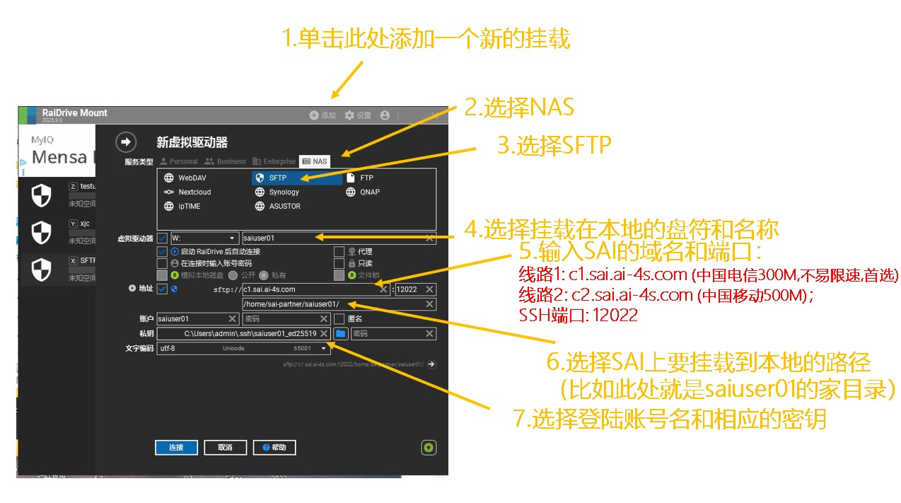
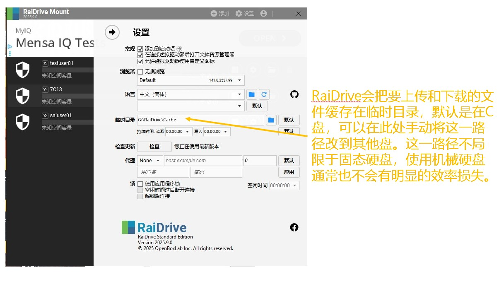

# 数据传输

## rclone挂载

rclone 可把 SFTP 等远程存储挂载为本地目录。首次配置先运行 `rclone config`，选择 SFTP，并填写[登录超算](../891ee584b71ab6f7b0d6d62d/index.md)中的主机、端口、用户名和密钥。挂载功能及依赖请按所在操作系统的 rclone 文档配置。

缓存可以让重复读写更顺手。开启写回缓存时，要等上传队列完成再提交计算或退出客户端。

GUI开发中：https://github.com/Stardust0831/ssh-mountmate

## 🔥 RaiDrive挂载 (强烈推荐)

对于Windows用户，推荐用RaiDrive的SFTP挂载，把集群存储挂载到资源管理器，像在本地硬盘上一样操作集群上的文件。

挂载后效果展示：


可以从该链接下载RaiDrive：https://www.raidrive.com/zh-hans/download


新建挂载时选择 NAS → SFTP，填写[登录信息](../891ee584b71ab6f7b0d6d62d/index.md)，目录填自己在集群上的实际路径。下图是控件位置示意，其中地址和目录需要替换：



缓存默认占用本机磁盘。C 盘空间紧张时，可在设置中换到其他磁盘；传输大文件前留足空间。



------------------------------------------------------------------------

## SFTP/SCP

少量文件直接用 MobaXterm 的 SFTP 面板拖放，很方便；也可使用命令行 `sftp`。需要重复同步整个目录时，推荐下面的 `rsync`：

``` bash
sftp -P 12022 username@c0.sai.ai-4s.com
# 在 sftp 提示符内：
put input.dat
get result.dat
bye
```

重复同步目录时，可在本机使用 rsync；先做预览，再去掉 `--dry-run` 执行：

``` bash
rsync -av --dry-run -e "ssh -p 12022" ./inputs/ username@c0.sai.ai-4s.com:/已授权的目标目录/
```

替换用户名和目标目录。源目录末尾的 `/` 表示复制其中的内容；大量小文件可先打包，通常比逐个传输快。


------------------------------------------------------------------------

## TRZSZ

SAI的登录节点已经预装了TRZSZ。

`trzsz` ( trz / tsz ) 是一款优秀的文件传输工具，和 lrzsz ( rz / sz ) 类似的、兼容 tmux 的文件传输工具。手册见https://trzsz.github.io/cn/

### TRZSZ支持的终端

- [trzsz-ssh](https://trzsz.github.io/cn/ssh) ( tssh ) – 内置支持 trzsz 的 ssh 客户端（ ⭐ 推荐 ）。
- [iTerm2](https://iterm2.com/) – 参考 [Trzsz-iTerm2 安装文档](https://trzsz.github.io/cn/iterm2)。
- [tabby](https://tabby.sh/) – 安装 [tabby-trzsz](https://github.com/trzsz/tabby-trzsz) 插件即可。
- [electerm](https://electerm.github.io/electerm/) – 升级到 `1.19.0` 以上的版本即可。
- [ttyd](https://github.com/tsl0922/ttyd) – 升级到 `1.7.3` 以上的版本，并且启动时加上 `-t enableTrzsz=true`，非 localhost 要用 `https`。
- [trzsz-go](https://trzsz.github.io/cn/go) – 只要是支持本地 shell 的终端就可以用。
- [trzsz.js](https://trzsz.github.io/cn/js) – 让运行在浏览器中的 webshell 和用 electron 开发的终端支持 `trzsz`。

### 使用指南

#### `trz` 上传文件

`trz` 命令可以不带任何参数，将上传文件到当前目录。也可以带一个目录参数，指定上传到哪个目录。

``` bash
trz .
```

#### `tsz` 下载文件

`tsz` 可以带一个或多个文件名（可使用相对路径或绝对路径，也可使用通配符），将下载指定的文件。

*登录shell*

    tsz file1 file2 file3

### 使用示例

![图片展示的是在Mac终端中执行\`trz\`命令上传文件后的界面。终端提示符显示为\`lonnywong@Mac15:/private/tmp/test\$\`，表明当前目录为\`/private/tmp/test\`。界面底部状态栏显示时间为“18:51 19-Mar-22”，终端编号为“\[0\]”，进程号为“0:bash\*”。该图片与文档中介绍\`trz\`上传文件功能的上下文对应，直观呈现了上传文件后的终端界面状态。](assets/3242758b5a5826305fd0b6c6427b1756aba6c183413aae4619ca80f9340510dc.gif)
