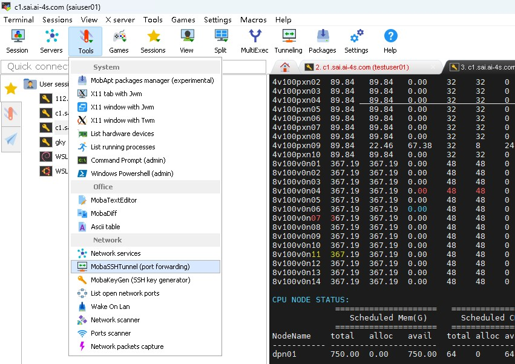

# 任务提交和管理

> SAI 的 Slurm 命令支持 **TAB 自动补全**，很好用，强烈推荐多试试。第一次提交可以先跟着[5分钟上手](../df8c6d77197060d17cc2d0d2/index.md)跑一遍。

> 从干净的登录会话提交任务，在脚本里加载计算环境。没有明确需要，不要额外设置 `--export`；使用 Agent 提交任务时也一样。

## ✨sbatch脚本模板`/opt/sbatch_examples`

> - 为了实现真正的“开箱即用”，SAI预置了大量sbatch脚本模板，路径为**`/opt/sbatch_examples`**
> - 模板列表及其介绍请看[软件环境](../f1d4bd8bb10f1064716136f5/index.md)
> - 模板会持续更新，不要把整个目录复制到 Home 后一直用。建议先建快捷入口：`ln -s /opt/sbatch_examples ~/exp`（`~/exp` 尚未被占用时执行）。用时把需要的脚本复制到工作目录再改，既能拿到新模板，也能保留本次计算的脚本。
> - 用户应按需修改sbatch脚本模板，灵活性就是脚本和命令行存在的意义
> - 对于不调用MPI的任务（如单卡任务，或程序本身不支持MPI），应将`--ntasks`参数指定为1，并删去`[CUDA-MPS] and [Rank-Map]`设置（参考脚本：`gpu_generic-nompi-mutigpu.sbatch`），否则可能会导致所有线程挤在少量CPU核心上

------------------------------------------------------------------------

## 批处理提交 `sbatch`

> Slurm支持利用`sbatch`命令采用批处理方式运行作业，`sbatch`命令在脚本正确传递给作业调度系统后立即退出，同时获取到一个作业号。作业等到系统中资源满足脚本中的指定后，将被调度到合适的计算节点上运行。可使用`squeue`命令查看作业号与作业状态。

脚本文件基本格式：

- 第1行以`#!/bin/``ba``sh`指定该脚本的解释器，`ba``sh`可以变为`sh`、`csh`等，在SAI中推荐使用`bash`
- 在可执行命令之前的每行`#SBATCH`前缀后跟的参数作为作业调度系统参数。 在任何非注释及空白之后的`#SBATCH`将不再作为Slurm参数处理

下面用 ABACUS 脚本说明资源参数；运行前从 `/opt/sbatch_examples` 取当前模板，并用 `sai account local --format table` 确认可用 Slurm 账户。软件模块名以当前模板为准。

简单解释：“默认身份”决定登录后的起始目录和默认账户。任务实际记到哪个账户，Slurm按以下优先级顺序决定：①你手动通过--account指定的账户；②作业工作目录；③门户网站上设置的默认身份。例如个人home目录通常记个人，组织下的个人目录、共享文件夹目录记组织，项目目录则记对应项目。

*sbatch脚本*

``` bash
#!/bin/bash
#SBATCH --job-name=ABACUS
#SBATCH --partition=4V100
#SBATCH --nodes=1
#SBATCH --ntasks=4          # Nodes * GPUs-per-node * Ranks-per-GPU
#SBATCH --gpus-per-node=4   # Specify the GPUs-per-node
#SBATCH --qos=rush-gpu      # Depending on your needs [Priority: rush-* > improper-* = huge-* > flood-* = ultimate-*]

# ⚠ DO NOT modify [CUDA-MPS] and [Rank-Map] settings unless you know what you are doing.
source /opt/sai_config/mps_mapping.d/${SLURM_JOB_PARTITION}.bash

# Below are executing commands
nvidia-smi dmon -s pucvmte -o T > nvdmon_job-$SLURM_JOB_ID.log &
module load abacus/LTSv3.10.1-sm70-auto
mpirun -np $SLURM_NTASKS --map-by $MAP_OPT -mca coll_hcoll_enable 0 abacus

# Must explicitly exit
exit
```

- `--job-name=ABACUS`指定了任务名为`ABACUS`
- `--partition=4V100`指定了使用`4V100`分区
- `--nodes=1`表示使用1个节点
- `--ntasks=4`应该设置为`Nodes` 、`GPUs-per-node` 和`Ranks-per-GPU`三者之乘积
  - **⚠**注意：此参数代表“进程数”，不代表“CPU核数”或“GPU卡数”，设置错误可能导致性能雪崩！
- `--gpus-per-node=4`指定了每个节点使用4个GPU
- `--qos=rush-gpu` 指定本例使用的 QOS。QOS 决定资源上限、时限及排队优先级；完整规则见[快速开始](../10e455cfa1c14a90040e58a5/index.md)。1–2 卡短时测试可考虑分区允许的 `rush-1o2gpu`。

任务提交后，可使用[`squeue`](https://vcnn7siwx4yx.feishu.cn/wiki/ZmkawnhNZicpxAkuwh4cNSWGnpc#KyZIdvMRyoeFFcxKX8FcB9XVnrb)查看任务排队与资源占用情况，可使用[`scancel`](https://vcnn7siwx4yx.feishu.cn/wiki/ZmkawnhNZicpxAkuwh4cNSWGnpc#X0D1d3HtvoGyjFxiH6ecUNxFntd)取消特定任务，后文将介绍细节

### [Job Array](https://slurm.schedmd.com/job_array.html)

对于同时提交大量相似任务的情况（例如上百乃至上万个DFT单点计算，每个任务只需几十~几百秒），务必使用Job Array功能，用法请查看[Slurm官方文档](https://slurm.schedmd.com/job_array.html)

------------------------------------------------------------------------

## 交互式提交 `srun`

> 资源分配与任务加载两步均通过`srun` 命令进行：当在登录shell中执行srun命令时，srun首先向系统提交作业请求并等待资源分配，然后在所分配的节点上加载作业任务。
>
> 采用该模式，用户在该终端需等待任务结束才能继续其它操作，在作业结束前，**如果提交时的命令行终端断开，则任务终止**。
>
> `srun`一般用于短时间测试性作业任务，若确实需要长时间运行`srun`，则推荐在[Tmux](https://blog.csdn.net/CSSDCC/article/details/121231906)中运行。

在 `srun` 后加 `--pty bash` 可打开计算节点终端。下例申请 4V100 的 1 卡、最多 5 分钟；先将 `ACCOUNT` 替换为 `sai account local --format table` 显示的可用账户。进入后正常计费，完成后执行 `exit` 释放资源。

```shell
srun --account=ACCOUNT --partition=4V100 --qos=rush-1o2gpu --nodes=1 --ntasks=1 --gpus-per-node=1 --time=00:05:00 --pty bash
```

可使用`srun --help`命令获得帮助信息，了解`srun`的各个参数的用途。

------------------------------------------------------------------------

## ✨查看任务状态 `squeue`

在登录节点运行 `sai jobs local --format table` 可查看任务，无需登录 Portal。也可使用 Slurm 的 `squeue`。

> 日常查看任务可直接用 `job`、`jm` 或 `sqm`；`ja`/`sqa` 查看当前计算账户范围。脚本或 Agent 用上一行的正式命令。

`squeue` 常用筛选：`-p` 分区、`-q` QOS、`-A` 账户、`-u` 用户、`-t` 状态。完整参数见 `squeue --help`。

下面用旧版任务列表说明各字段；任务 ID、节点和时间仅作示例。

*squeue*

```shell
job-ID  Prior  Name          User            Submit/Start at      ST  Run/Wait     Partition  QOS          Nodes  Slots  GPU  MemPerU  array_ID  Reason/Nodelist
----------------------------------------------------------------------------------------------------------------------------------------------------------------
114514  6076   VASP          testuser01      2025-10-24 10:52:25  R   10:53:56     8V100V0    huge-gpu     12     576    8    47000M   -         8v100v0n[02-13]
114515  10176  DP_MD         testuser01      2025-10-24 11:19:13  R   10:27:08     4V100      rush-gpu    2      48     4    23000M   -         4v100pxn[01-02]
114516  6077   ABACUS        testuser01      2025-10-24 10:44:21  PD  11:02:00     4V100      huge-gpu     2      16     4    23000M   -         (Resources)
114517  6076   DP_MD         testuser01      2025-10-24 10:53:10  PD  10:52:41     8V100V0    huge-gpu     12     192    8    47000M   -         (Resources)
Note: 1. 'GPU' indicates per-Node allocation of GPUs.
      2. 'MemPerU' indicates per-GPU or per-CPU-Core allocation of Host-Memory.
```

> 阅读上述字段示例时，注意：
>
> 1.  `GPU`：每节点的GPU数量，而非GPU总数
> 2.  `MemPerU`：每个GPU(GPU分区)或每个CPU逻辑核(CPU分区)所分配的CPU内存，而非总内存或显存
>
> 此外还需注意：
>
> - `Slots` 不能直接当作 GPU 数或 MPI 进程数。资源分配后，用 `scontrol show job <任务ID>` 核对 `NumCPUs`、`NumTasks` 和 GPU 申请；CPU 按分区的每卡规则配套分配。

其他字段解释（由用户指定的参数，可通过提交命令、Sbatch脚本或`scontrol update`指定）：

- `job-ID`：任务编号，每个任务唯一（不包括Job Array的子任务）
- `Prior`：任务优先级，在排队过程中动态变化，计算方式[在此](https://vcnn7siwx4yx.feishu.cn/wiki/JEdOwsjbdirwA3kTDW0cBwQWnVe#Z9HAdEHI4otWgZxNE2rcFe45nfb)
- `Name`：任务名称，由用户指定
- `User`：任务所属用户名
- `Submit/Start at`：任务的提交时间（PD）或开始时间（R/CG/S）
- `ST`：任务状态（PD：排队中，R：运行中，S：暂停中，CG：即将完成）
- `Run/Wait`：已运行或等待的时间
- `Partition`：任务申请的分区（PD）或分配到的分区（R/CG/S），由用户指定，用户可指定分区列表，但最终只分配1个分区
- `QOS`：任务的QOS，由用户指定
- `Nodes`：节点数量，由用户指定
- `array_ID`：Job Array的子任务编号
- `Reason/Nodelist`：若任务状态为PD，则显示PD的原因；若任务状态为R/CG/S，则显示分配到的节点列表；用户可指定要调用的节点列表或要排除的节点列表，参考提交命令的文档

------------------------------------------------------------------------

## 查看任务详细信息 `scontrol`/`sacct`

> 多用**TAB键**！

`scontrol show job`只能显示正在运行或者刚结束不久的任务信息，用法如下：

*登录shell*

``` bash
scontrol show job <任务ID>  # 或简写为 ssj <任务ID>
```

通过`sacct`查询已经结束任务的相关信息，如下所示：

*登录shell*

``` bash
# 显示已知JobID的任务的一般信息
sacct -X -j <任务ID>
# 显示开始于某个时间点之后的任务的一般信息,支持通过方向键滚动,按q退出交互界面
sacct -X -S <开始时间(默认今天0点)> | less -SN
# 寻找开始于某个时段内任务的工作目录,"%200"表示此字段最长显示200字符,支持通过方向键滚动,按q退出交互界面
sacct -X -S <开始时间(默认今天0点)> -E <结束时间(默认现在)> --format=jobid,jobname,workdir%200 | less -SN
# 显示开始于某个时段内任务的全部信息,每个字段长度50字符,支持通过方向键滚动,按q退出交互界面
sacct -X -S <开始时间(默认今天0点)> -E <结束时间(默认现在)> --format=all%50 | less -SN
# 例：查询2026-02-20下午14:30:00后所有任务的运行节点、QOS、开始结束时间、工作目录等信息，并滚动查看
sacct -X --format=jobid,jobname%15,NodeList,QOS%15,Start,End,State,AllocTRES%50,workdir%90 -S 2026-02-20T14:30:00 | less -SN
```

💡`sacct`的重点功能非常多，无法逐一列举，建议阅读[Slurm官方文档](https://slurm.schedmd.com/sacct.html)，并多用**TAB键**来补全命令

> `sacct` 记录作业运行情况；最终扣费和账单明细请查看[账号、计费与资金](../de0cae9d9928cde1be3cc6b6/index.md)。

------------------------------------------------------------------------

## 修改排队任务，无需重新提交

> `scontrol update` 可以直接调整自己的排队任务，保留作业 ID。多项参数要一起改时，先 `scontrol hold JOB_ID` 暂停调度，改完用 `scontrol show job JOB_ID` 看结果，再 `scontrol release JOB_ID` 放行。下面的 `JOB_ID` 换成自己的任务号。

### 修改分区

*Shell*

``` bash
scontrol update jobid=<任务ID> partition=<新分区>
```

### 修改QOS

*Shell*

``` bash
scontrol update jobid=<任务ID> qos=<新QOS>
```

### 修改每节点GPU数量

例如：任务在 `16V100` 分区，使用 1 个节点、每卡 1 个 Rank。把每节点 4 卡改成 8 卡：

``` bash
scontrol update JobId=JOB_ID Gres=gpu:8 NumTasks=8 NumCPUs=64
```

`NumTasks` 是总 MPI 进程数。这里的 `NumCPUs` 是总 CPU 逻辑核数，按该分区每 GPU 8 个逻辑核计算；它与提交脚本中的 `--cpus-per-task` 不是一回事。

### 修改节点数量

接上例，将 1 个节点改为 2 个节点，仍为每节点 8 卡、每卡 1 个 Rank：

``` bash
scontrol update JobId=JOB_ID NumNodes=2 NumTasks=16 NumCPUs=128
```

### 修改CUDA-MPS的`Ranks-per-GPU`

在上面的 2 节点、每节点 8 卡配置中，把每卡 1 个 Rank 改为 2 个 Rank：

``` bash
scontrol update JobId=JOB_ID NumTasks=32 NumCPUs=128
```

GPU 数没变，配套 CPU 数也不变。应用必须支持对应的每卡多 Rank 配置，MPS 用法见[性能调优](../1ff92c0337e3d406c61a8e77/index.md)。

### Tips

- `jobid=<任务ID>`也可用`jobid=[任务ID列表]`（格式如`[114-514,1919,810]`）或`jobname=<任务名称>`代替
- 运行中的任务先保存检查点，再用 `scontrol requeuehold JOB_ID` 停止当前执行并重新排队。修改后 `scontrol release JOB_ID` 放行，续算由程序和脚本处理；已经运行的费用照常结算。

#### 同时调整多项资源

例如在 `16V100` 分区同时改为 4 个节点、每节点 16 卡、每卡 2 个 Rank，并选择 `huge-gpu`：总 GPU 数为 64，总 Rank 数为 128，CPU 为 512 个逻辑核。

``` bash
scontrol update JobId=JOB_ID NumNodes=4 Gres=gpu:16 NumTasks=128 NumCPUs=512 QOS=huge-gpu
scontrol show job JOB_ID
```

看输出中的 `Partition`、`QOS`、`NumNodes`、`NumTasks`、`NumCPUs` 和 `TresPerNode`，确认各项对应。跨分区修改还要匹配目标分区的每卡 CPU/内存规则；不要照搬另一个分区的数字。

### 降低任务优先级

场景：有一批QOS为`improper-gpu`的单卡任务已在队列中，每个任务运行时间很短；此后又提交了若干QOS为`improper-gpu`的单卡任务，每个任务运行时间很长。现希望晚交的长任务插队到先交的短任务之前。

操作：`scontrol update jobid=<先提交的短任务的jobid列表> nice=<降低的优先级指数(正整数)>`

原理：`nice`参数用于手动控制任务优先级，正值会降低任务的优先级，负值会增加任务的优先级（只有管理员可以指定负值），调整范围是+/-2147483645。

### `scontrol`的其他重要功能

- `scontrol hold <任务ID>`：暂不启动排队中的任务。
- `scontrol requeue <任务ID>`：重新排队；运行中的任务会停止，续算依赖程序检查点。
- `scontrol suspend <任务ID>`：需要相应权限；暂停不等于释放全部资源或停止计费。
- ……

💡`scontrol`的重要功能非常多，无法逐一列举，建议阅读[Slurm官方文档](https://slurm.schedmd.com/scontrol.html)，并多用**TAB键**来补全命令

> `scontrol`对于管理员来说也是非常重要的工具

------------------------------------------------------------------------

## 取消任务 `scancel`

可使用`scancel <任务ID>`、`scancel --name=<任务名称>`等命令取消符合条件的特定任务

具体用法参见`scancel --help`或[Slurm官方文档](https://slurm.schedmd.com/scancel.html)，这对于批量取消任务很有用

💡对于Job-ID连续的一系列任务，可使用bash的`{a..b}`语法，例如取消Job-ID从114514到114520的7个任务：`scancel {114514..114520}`

------------------------------------------------------------------------

## ✨查看计算节点空闲状态 **`gpu`/`cpu`**

想知道哪些节点空闲，日常直接用 `gpu` 或 `cpu`。脚本或 Agent 可用 `sai resources local --format table`；详细分区规则用 `scontrol show partition 分区名`。

### GPU 资源

查看实时资源，并核对计划使用分区的 QOS：

```shell
sai resources local --format table
scontrol show partition 4V100
```

用户日常使用最需要关注的信息如下：

- **GPU 总量**：节点的资源规模，不等于当前可申请数量。
- **空闲 GPU**：当前尚未分配的数量；任务还需满足 QOS、账户额度和节点状态等条件。
- **CPU 资源**：区分物理核心、逻辑核心和 MPI 进程数；不要仅凭节点总 CPU 数推算任务的 `Ranks-per-GPU`。
- `Status`字段：`IDLE`表示计算节点完全空闲，`MIXED`表示计算节点部分空闲，`ALLOCATED`表示计算节点被全部占用
- **可用 QOS**：查看 `scontrol show partition <分区名>` 中的 `AllowQos`。单卡 QOS 已不限于 4V100，各分区允许的组合不同，完整规则见[快速开始](../10e455cfa1c14a90040e58a5/index.md)。

### `cpu`

CPU 分区同样可用以下命令核对：

```shell
sai resources local --format table
scontrol show partition CPU-MISC
scontrol show partition DSPRHBM
```

2026-10-13 核验：CPU-MISC 只允许 `rush-cpu`；DSPRHBM 允许 `rush-cpu` 和 `huge-cpu`。

CPU 配额以 Slurm 的逻辑核心数为准。`--ntasks` 表示任务进程数，不能直接当作物理核心数。

## 进入计算节点查看任务和硬件状态

### SSH连接

> 任务进入运行状态后，可连接自己任务分配到的计算节点，使用 `nvidia-smi`、`nvidia-smi dmon` 或 `btop` 查看状态。

以下是一个SSH连接的示例：

用 `job` 或 `sqm` 找到正在运行的任务，从节点列取得名字，再执行 `ssh 节点名`。下图演示这几步：


连接到计算节点后可以使用`nv``dmon`、`btop`等命令查看各种硬件的动态监控。同时在屏幕上可以看到集群系统中为用户定制的特殊命令和别名说明（在登录到登录节点时也会显示）。

![图片展示了在集群系统中为用户定制的特殊命令和别名。画面中显示了系统信息，如系统负载、温度、内存使用等。下方列出了一系列命令，如\`module av\`列出所有可用模块，\`ssh\`连接到任务所在节点，\`ssh -l\`列出所有用户，\`ssh -l -q\`列出所有用户，\`ssh -l -q -p\`列出所有用户，\`ssh -l -q -p -u\`列出所有用户，\`ssh -l -q -p -u -t\`列出所有用户，\`ssh -l -q -p -u -t -s\`列出所有用户，\`ssh -l -q -p -u -t -s -d\`列出所有用户，\`ssh -l -q -p -u -t -s -d -m\`列出所有用户，\`ssh -l -q -p -u -t -s -d -m -n\`列出所有用户，\`ssh -l -q -p -u -t -s -d -m -n -c\`列出所有用户，\`ssh -l -q -p -u -t -s -d -m -n -c -t\`列出所有用户，\`ssh -l -q -p -u -t -s -d -m -n -c -t -s\`列出所有用户，\`ssh -l -q -p -u -t -s -d -m -n -c -t -s -d\`列出所有用户，\`ssh -l -q -p -u -t -s -d -m -n -c -t -s -d -m\`列出所有用户，\`ssh -l -q -p -u -t -s -d -m -n -c -t -s -d -m -n\`列出所有用户，\`ssh -l -q -p -u -t -s -d -m -n -c -t -s -d -m -n -c\`列出所有用户，\`ssh -l -q -p -u -t -s -d -m -n -c -t -s -d -m -n -c -t\`列出所有用户，\`ssh -l -q -p -u -t -s -d -m -n -c -t -s -d -m](assets/2d1c15d804e2e3137cd5b7f8d68ab5f1a7679e1120577e8be79401b8cb816ae7.jpeg)

### GPU动态监控 `nvdmon`

`nvdmon`命令是`nvidia-smi dmon -s pucvmte -o T`命令的alias，用于监控job在当前计算节点所调用的GPU的详细状态，其输出信息的解释如下：


> 实践中往往会看到“SM活跃度”达到了80%以上，但GPU功率远未达到标准TDP/TGP (对于V100是300W) 的情况，这一般有3种原因：
>
> 1.  程序每批次“喂”给GPU的任务太少 (CUDA kernel太小)，或并行度不够，无法占满SM后端执行单元
> 2.  程序遇到了严重的“内存墙”，大部分时间都在进行显存的读写 (这种情况下往往会看到接近100%的显存带宽利用率)
> 3.  程序的GPU间通信通过GPU-Direct完成，但通信开销大，SM大部分时间都在执行通信任务。值得注意的是，这种情况下PCIe吞吐或NVLink吞吐不一定很大，因为瓶颈有可能是通信延迟

### NVLink吞吐监控 `nvltm`

`nvltm`命令是`watch -n 0.1 nvidia-smi nvlink -gt d`命令的alias，用于监控job在当前计算节点所调用的GPU的NVLink数据吞吐情况，以便评估程序是否正在高效利用NVLink

### ✨Netdata服务

如任务所在节点提供[Netdata](https://www.netdata.cloud)，可通过网页查看 CPU、内存、GPU、网络和存储状态，辅助性能分析与排错。

历史数据保留范围以该节点页面实际可查的时间为准；排错时请记录任务 ID、节点和起止时间。

下面用 MobaXterm 的 MobaSSHTunnel 建立本地端口转发。截图为旧版示意：登录主机和端口请使用[登录超算](../891ee584b71ab6f7b0d6d62d/index.md)中的当前连接信息；远程目标是自己任务所在节点的 `19999` 端口。

MobaSSHTunnel可通过如下方式打开：



随后创建SSH Tunnel：


参考下图完成配置：


随后在浏览器中访问`localhost:19999/v3` 即可查看计算节点的Netdata网页。需保证此时访问的端口号与SSH Tunnel中转发到本地的端口号一致。本地端口号可按需自行修改，上述URL中的端口号也需随之修改。


------------------------------------------------------------------------

## 💡FAQ

#### Q: “error：QOSMinGRES”是什么报错？


> **A：**申请的 GPU 数低于所选 QOS 的最低要求。先对照脚本中的 GPU 数和 QOS，再查[快速开始的 QOS 规则](../10e455cfa1c14a90040e58a5/index.md)。以下图片是历史报错示意。
>
> ![图片展示的是一个系统提示信息，其中关键内容被红色框突出显示。提示信息指出，不满足\[GPUsPerNode=4N(N\>0)\]条件的任务，对某些QOS来说是不允许的，若要使用不正确的GPU数量，请选择专门的QOS和分区。该图片与上文“下面这些任务的排队原因是什么？”的问题相关，是对其中“排队原因1：AssocGrpGRES”中任务排队原因的说明，即因不满足GPU数量条件而被某些QOS拒绝。](assets/5febd4b4bb314d8667f32c701133ff31191d60eafb669882fc91bf8506a8d1af.png)
>
> 申请 1 或 2 卡时，可选择该分区允许的 `improper-gpu`、`rush-1o2gpu` 或 `flood-1o2gpu`。用 `scontrol show partition <分区名>` 核对 `AllowQos`；只改 QOS 名称仍需满足时限和额度要求。
>
> 

------------------------------------------------------------------------

#### **Q:下面这些任务的排队原因是什么？**

排队原因1：`AssocGrpGRES`


这个账户同时使用的 GPU 已经达到总额度，需等已有任务结束，或联系管理员增加额度。用 `sai account local --format table` 查看自己的账户关联；图中 64 卡是当时这个账户的额度。

排队原因2：`QOSMaxGRESPerUser`


你在所选 QOS 下同时使用的 GPU 达到每用户上限了。用 `job` 看正在运行的任务，再对照[快速开始](../10e455cfa1c14a90040e58a5/index.md)的 QOS 表；当前提交用表中的名称。

------------------------------------------------------------------------

#### **Q:为什么我的任务CANCELLED by 0？**

`CANCELLED by 0` 表示由 root 身份执行了取消。先看任务输出中的站点检查提示，再运行下面的命令查记录：

``` bash
sacct -X -j JOB_ID -o JobID,State%30,Reason,ExitCode
```

如果看不出原因，把任务 ID、发生时间和报错交给管理员。资源检查、系统保护和管理员操作都可能触发这种取消。

#### Q: 任务 suspend（暂停）后还会计费吗？

> **A：**会。suspend 只是暂停程序，内存等资源仍被占用，暂停期间正常计费。要结束这次计算并释放资源，请用 scancel JOB_ID，随后确认任务已结束。

#### Q: GPU 利用率为 0，还会计费吗？

> **A：**会。计算费用按任务占用的资源和时间计算。读文件、等待通信或程序卡住时，资源仍可能被占用；请查日志和监控，及时取消不再需要的任务。

#### Q: 排队、hold 和 suspend 的费用一样吗？

> **A：**普通按量任务在首次启动前排队，尚未占用计算资源，这段时间不收计算费；hold 是让未启动的任务暂缓调度。suspend 是暂停已运行的任务，仍保留资源，正常计费。预约资源、订阅等另按订单约定。

#### Q: 关闭 SSH 或 Pilot 网页，任务就结束了吗？

> **A：**已提交的 sbatch 任务会继续，资源占用期间照常计费。交互式 srun 则可能随终端断开而结束，使用 tmux 时还可能继续。以任务状态为准；要结束计算，请取消对应任务。

#### Q: 程序报错、计算失败，已经花的费用怎么算？

> **A：**已占用资源的时间仍计费。主程序退出后，脚本里的等待或后续命令还可能使任务继续占用资源。发现错误后查任务状态，及时结束无用的计算。

#### Q: scancel 执行完，就已经停止计费了吗？

> **A：**先确认任务已经结束并释放资源。取消请求发出后可能还有清理过程；如果长时间停在 COMPLETING 或仍占着节点，把任务 ID 和时间交给管理员。

#### Q: 想过几天再继续算，可以一直 suspend 吗？

> **A：**暂停期间仍正常计费。需要长期停下来时，先按软件支持的方式保存检查点，再结束任务；之后从检查点重新提交。

#### Q: 切换默认身份后，之前提交的任务也会换账户吗？

> **A：**已提交任务保留原来的账户。新任务先用命令、脚本或环境变量指定的账户，其次按工作目录推定，最后用本站已生效的默认账户；排队任务若需更正账户，应单独修改并核对。

#### Q: 余额不足，任务会自动停止吗？

> **A：**是否自动取消取决于站点规则。任务仍在运行或暂停时，资源占用继续计费。收到欠费提醒后，请及时补足资金；需要停止计算时，请取消对应任务并确认已结束。

#### Q: 通知说任务会被取消，到了时间却还在运行或暂停，怎么办？

> **A：**请保留任务编号和通知，联系管理员核查实际停止时间及费用。需要立即停止计算时，用 scancel JOB_ID 取消，并确认任务已结束。
