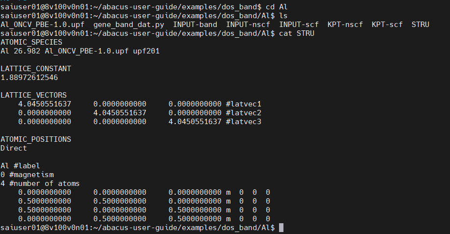
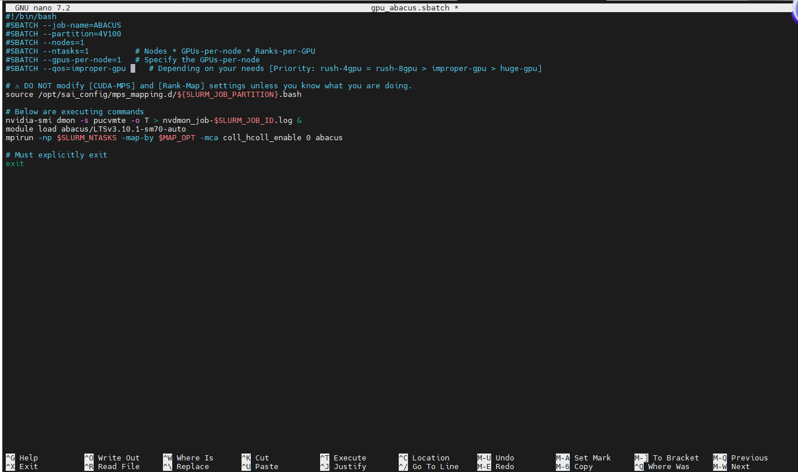
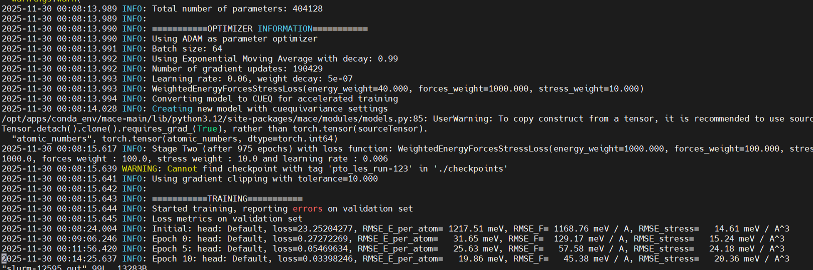

# 常见软件用法

### ABACUS：提交一次 SCF 计算

本例使用铝的结构，演示准备输入并提交 ABACUS 自洽场（SCF）计算。DOS 和能带的后续步骤请继续参考 [ABACUS 用户指南](https://mcresearch.github.io/abacus-user-guide/abacus-dos.html)。

先下载该用户指南的示例仓库：

*登录shell*

    git clone https://gitee.com/mcresearch/abacus-user-guide.git


下载完成后，进入`abacus-user-guide/examples/dos_band` 文件夹，可以看到里面有 `Al` 和 `Fe` 两个文件夹。进入 `Al` 文件夹，可以看到相应的example文件，其中`STRU`是铝结构优化后的 fcc 单胞结构：



刚才如果还在计算节点玩耍，先 `exit` 回到登录节点。下面准备输入文件，正式计算再用 `sbatch` 提交。

做 DOS 和能带时通常使用原胞。这里先用 Atomkit 转换结构，为本节 SCF 计算和后续步骤作准备：

*登录shell*

``` bash
ml load atomkit
```


确保atomkit被激活后，使用以下命令得到原胞 `PRIMCELL.STRU`

*登录shell*

    echo -e "2\n 202\n 101 STRU\n 101" | atomkit

> 这里为了方便演示，使用了命令行，表示将'2'、'202'、'101 STRU'和'101'依次传入atomkit，实际可以按照atomkit的提示依次输入\
> 2代表进行Symmetry Analysis
>
> 202代表进行Find Primitive Cell
>
> 101 STRU代表读取ABACUS的STRU文件
>
> 101代表输出格式为ABACUS

转换后用 `ml purge` 卸载模块；如果还开着 Conda，再执行 `conda deactivate`。回到干净环境后提交任务，计算环境由脚本加载。

首先进行SCF计算来获取电子密度，ABACUS运行依赖于`INPUT`文件、`KPT`文件和结构文件，我们复制scf计算的example文件为相应的文件名。而结构文件在`INPUT`文件中被设定为了我们上一步得到的`PRIMCELL.STRU`。该步操作的具体命令：

*登录shell*

    cp INPUT-scf INPUT
    cp KPT-scf KPT


随后我们从`/opt/sbatch_examples`目录获取提交ABACUS任务所需的模板文件并复制到当前目录：

*登录shell*

    cp /opt/sbatch_examples/gpu_abacus.sbatch .


*登录shell*

    nano gpu_abacus.sbatch

用 `nano` 修改分区、节点数、GPU 数和 QOS。`--ntasks` 要与总 GPU 数和每卡 Rank 数配套，别只改卡数忘了进程数。下图展示编辑位置：



修改完成后，使用ctrl+o快捷键来保存，并ctrl+x快捷键退出。

我们使用如下命令来提交修改过后的sbatch脚本：

*登录shell*

    sbatch gpu_abacus.sbatch


用 [任务提交和管理](../263082edffdfc401aebd0e23/index.md) 中的 `squeue` 查看排队和运行状态，`gpu` 查看 GPU 资源。作业结束后还要检查 Slurm 日志和 ABACUS 输出，确认 SCF 收敛；进入运行状态或从队列消失都不等于计算成功。


------------------------------------------------------------------------

### MACE的训练和使用

本节介绍如何在SAI上进行MACE的训练，以及如何在LAMMPS上使用MACE进行多GPU并行的MD模拟。

本节输入文件位于 `/home/public/tutorial/MACE`。将需要的算例复制到自己的工作目录后运行。

#### 模型训练

我们将以(Pb,Sr)TiO<span class="math">$`_3`$</span>钙钛矿固溶体为例，展示如何训练一个MACE模型。

(该数据集来自文献：PRB 107,144102(2023); DOI: https://doi.org/10.1103/PhysRevB.107.144102)

**（任务提交）**仅需几行指令，您便可在SAI上提交一个MACE训练任务：

``` bash
cp -r /home/public/tutorial/MACE/01-training .
cd 01-training
ls
# config.yaml：MACE 输入；les_config.yaml：MACE-LES 输入
# train.xyz：训练集；test.xyz：测试集
nano gpu_mace-train.sbatch   # 核对环境、输入文件和资源设置
sbatch gpu_mace-train.sbatch
```

**查看状态：**运行 `sqm` 查看自己的任务；状态及等待原因以当前输出为准。下图是一次历史运行示例。


**（输出文件检查）**使用`vim`打开输出日志，即可检查MACE的输出，这里已经训练到第10个Epoch：



**（资源）**本节的重点不在详细介绍MACE如何使用。如果您想了解MACE的参数，这里推荐一些或许有用的资源：

1.  https://mace-docs.readthedocs.io/en/latest/index.html (MACE官方文档）
2.  https://github.com/ACEsuit/mace （MACE官方仓库）
3.  https://mp.weixin.qq.com/s/pXvkUunxyqJ7Lh4KPV7L0g（MACE环境配置）
4.  https://mp.weixin.qq.com/s/A46QCdyzHD6EDvPRrgrV4g（MACE-LES代码解析）

#### 模型格式转换

MACE训练结束后，会产生一个`.model`后缀的文件。这个模型无法直接被LAMMPS读取，我们需要先将其转化为可用的模型格式。

目前MACE在LAMMPS中有2个可用接口，不同接口采用的模型格式不同：

- [MACE in LAMMPS](https://mace-docs.readthedocs.io/en/latest/guide/lammps.html) （早期版本，性能较低，**不推荐**）
- [MACE in LAMMPS with ML-IAP](https://mace-docs.readthedocs.io/en/latest/guide/lammps_mliap.html)（新接口，专为GPU优化，**推荐**）

本节我们只介绍第二个接口的使用方法。

**（任务提交）**仅需几行指令，您便可在SAI上提交该任务：

``` bash
cp -r /home/public/tutorial/MACE/02-lammps .
cd 02-lammps/01-make-model
ls
# mace-omat-0-medium.model：示例模型，可替换为自己的模型
nano submit.sbatch          # 检查模型文件名、环境和资源设置
sbatch submit.sbatch
```

**检查结果：**作业完成后查看日志是否报错，并确认当前目录生成 `mace-omat-0-medium.model-mliap_lammps.pt`。使用其他模型时，输出文件名相应变化。

#### LAMMPS中使用MACE

本节，我们将基于上节得到的模型，在LAMMPS中进行多GPU并行的MD模拟。

**提交 MD 任务：**上一步模型转换成功后，从 `01-make-model` 进入同级的 `02-run-MD` 目录。先确认输入中的模型路径指向刚生成的文件。

``` bash
cd ../02-run-MD
ls conf.lmp input.lammps gpu_lmp-mace.sbatch
nano input.lammps            # 检查模型路径、元素顺序和模拟参数
nano gpu_lmp-mace.sbatch     # 检查分区、GPU 数和 QOS
sbatch gpu_lmp-mace.sbatch
```

**（输入文件）**我们简要解析下LAMMPS输入文件的关键内容：

（为了简洁，下面只**列举关键内容**，完整文档请前往[官网](https://mace-docs.readthedocs.io/en/latest/guide/lammps_mliap.html#using-mace-with-ml-iap-in-lammps)）

    units           metal
    boundary        p p p
    atom_style      atomic
    newton          on     # 必须打开

    neighbor        2.0 bin
    neigh_modify    every 1

    read_data       conf.lmp

    # MACE模型设置
    pair_style      mliap unified ../01-make-model/mace-omat-0-medium.model-mliap_lammps.pt 0
    pair_coeff      * * Sr Pb Ti O # 需要与结构文件中的原子类型对应

    velocity        all create ${TEMP} 539619
    fix             1 all npt temp 300 300 1 z 0 0 5
    timestep        0.002000
    run             1000

**提交脚本示例：**下例申请 4 个节点、每节点 4 张 GPU，共 16 张 GPU。这是示例规模；请按实际任务调整节点数、GPU 数、MPI 进程数和 QOS，先用短任务验证结果及资源利用率。

``` bash
#!/bin/bash
#SBATCH --job-name=LMP
#SBATCH --partition=4V100
#SBATCH --nodes=4
#SBATCH --ntasks=16         # Nodes * GPUs-per-node * Ranks-per-GPU
#SBATCH --gpus-per-node=4   # Specify the GPUs-per-node
#SBATCH --qos=huge-gpu      # 按当前 QOS 规则选择

# ⚠ DO NOT modify [CUDA-MPS] and [Rank-Map] settings unless you know what you are doing.
source /opt/sai/runtime/mps_mapping.d/${SLURM_JOB_PARTITION}.bash

export OMP_NUM_THREADS=2

# Below are executing commands
nvidia-smi dmon -s pucvmte -o T > nvdmon_job-$SLURM_JOB_ID.log &

module purge
module load lammps/25jul2025-mace-0.3.15

mpirun -np $SLURM_NTASKS -map-by $MAP_OPT lmp -k on g $SLURM_GPUS_ON_NODE -sf kk -pk kokkos cuda/aware on neigh half comm device newton on -in input.lammps

# Must explicitly exit
exit
```

**（输出文件）**使用`vim`打开`log.lammps`即可查看输出的任务日志，这里展示最后一部分，笔者将自认为重要的部分**标红**：

``` yaml
       980   176.58434     -126924.75      385.15441     -126539.6      -10024.276      225144.6       59.37          59.37          63.874488
       990   178.49146     -126927.81      389.3141      -126538.5      -9362.952       225221.08      59.37          59.37          63.896188
      1000   177.35574     -126924.33      386.83694     -126537.5      -9487.2508      225295.86      59.37          59.37          63.917403
Loop time of 94.9775 on 16 procs for 1000 steps with 16875 atoms

Performance: 1.819 ns/day（性能）, 13.191 hours/ns, 10.529 timesteps/s, 177.674 katom-step/s
99.2% CPU use with 16 MPI tasks x 1 OpenMP threads

MPI task timing breakdown:
Section |  min time  |  avg time  |  max time  |%varavg| %total
---------------------------------------------------------------
Pair    | 91.605     | 92.409     | 93.044     |   4.3 | 97.30
Neigh   | 0.0029915  | 0.0037048  | 0.0080641  |   1.9 |  0.00
Comm    | 1.0875     | 1.7143     | 2.5117     |  31.3 |  1.80
Output  | 0.32176    | 0.35433    | 0.39619    |   2.9 |  0.37
Modify  | 0.32575    | 0.37351    | 0.40621    |   3.1 |  0.39
Other   |            | 0.1225     |            |       |  0.13

Nlocal:        1054.69 ave        1095 max         997 min
Histogram: 2 0 1 1 1 1 3 4 2 1
Nghost:        4140.62 ave        4212 max        4042 min
Histogram: 2 2 0 1 2 1 1 0 1 6
Neighs:              0 ave           0 max           0 min
Histogram: 16 0 0 0 0 0 0 0 0 0
FullNghs:       167784 ave      173977 max      158286 min
Histogram: 2 0 1 1 1 0 3 4 2 2

Total # of neighbors = 2684538
Ave neighs/atom = 159.08373
Neighbor list builds = 7
Dangerous builds = 0
write_restart   eq.restart
System init for write_restart ...
write_data      eq.data
System init for write_data ...

Total wall time: 0:02:25 # 总耗时
```

本例使用 MACE。MACE-LES 的 LAMMPS 接口请查对应版本说明，历史问题见 [issue \#1283](https://github.com/ACEsuit/mace/issues/1283)。

#### MD效率测试

比较性能时固定结构、模型、精度与模拟步数，分别记录不同 GPU 数下的 `Performance` 和总耗时。先检查结果一致性，再判断增加 GPU 是否有收益；上方日志只代表该次示例运行。

------------------------------------------------------------------------

### AlphaFold3蛋白质结构预测

#### “一梭子”用法：一次完成 MSA 和推理

使用通用单卡Sbatch模板`/opt/sbatch_examples/gpu_generic-singlegpu.sbatch`

填写运行命令：

*AF3一梭子运行*

``` bash
module load alphafold/3.0.1
run_alphafold3.0.1.sh <输入文件所在目录> <输出文件所在目录> <输入文件(json格式)>
```

#### 省钱用法：CPU 做 MSA，GPU 做推理

MSA 阶段不需要一直占着 GPU。先在 CPU 节点生成带 MSA 的输入，再把推理交给 GPU，减少 GPU 空等的时间。

##### 第一步：MSA计算 (CPU-only)

Sbatch模板：`/opt/sbatch_examples/af3_st1_msa.sbatch`

*af3_st1_msa.sbatch*

``` bash
#!/bin/bash
#SBATCH --job-name=AF3-MSA
#SBATCH --partition=CPU-MISC
#SBATCH --nodes=1           # Specify the number of Node(s)
#SBATCH --ntasks=1          # Specify the number of MPI Rank(s)
#SBATCH --cpus-per-task=8   # Specify the number of CPU Core(s) of each MPI Rank
#SBATCH --qos=rush-cpu      # CPU-MISC 使用 rush-cpu

module load alphafold/3.0.1

# 手动填写以下文件路径
AF3_INPUT_JSON='af3.json'
AF3_INPUT_DIR='.'
AF3_OUT_DIR='af3-out'
# 文件路径设置完毕

mkdir -p $AF3_OUT_DIR

apptainer exec \
        --bind $AF3_INPUT_DIR:/root/af_input \
        --bind $AF3_OUT_DIR:/root/af_output \
        --bind /cache_local/alphafold/af3_data/af3_data/:/root/public_databases \
        /opt/apps/alphafold/3.0.1/alphafold3.0.1-um-modify.sif \
python /app/alphafold/run_alphafold.py \
        --json_path=/root/af_input/$AF3_INPUT_JSON \
        --db_dir=/root/public_databases \
        --output_dir=/root/af_output/ \
        --norun_inference
```

##### 第二步：推理 (GPU加速)

Sbatch模板：`/opt/sbatch_examples/af3_st2_infer.sbatch`

*af3_st2_infer.sbatch*

``` bash
#!/bin/bash
#SBATCH --job-name=AF3-Inference
#SBATCH --partition=4V100
#SBATCH --nodes=1
#SBATCH --ntasks=1          # Nodes * GPUs-per-node * Ranks-per-GPU
#SBATCH --gpus-per-node=1   # Specify the GPUs-per-node
#SBATCH --qos=improper-gpu  # 按当前 QOS 规则选择

nvidia-smi dmon -s pucvmte -o T > nvdmon_job-$SLURM_JOB_ID.log &

module load alphafold/3.0.1

# 手动填写以下文件路径
AF3_INPUT_JSON='af3_data.json'  # 此文件由上一步MSA计算输出，后缀固定为'_data.json'，前缀取决于用户在上一步输入json中设置的蛋白质名称
AF3_INPUT_DIR='af3-out/af3'     # 此路径为上一行指定的文件所在路径
AF3_OUT_DIR='af3-out'
# 文件路径设置完毕

mkdir -p $AF3_OUT_DIR

apptainer exec \
        --nv \
        --bind $AF3_INPUT_DIR:/root/af_input \
        --bind $AF3_OUT_DIR:/root/af_output \
        --bind /cache_local/alphafold/af3_data/af3_models/:/root/models \
        --bind /cache_local/alphafold/af3_data/af3_data/:/root/public_databases \
        --env XLA_FLAGS="--xla_disable_hlo_passes=custom-kernel-fusion-rewriter" \
        /opt/apps/alphafold/3.0.1/alphafold3.0.1-um-modify.sif \
python /app/alphafold/run_alphafold.py \
        --json_path=/root/af_input/$AF3_INPUT_JSON \
        --model_dir=/root/models \
        --db_dir=/root/public_databases \
        --output_dir=/root/af_output/ \
        --norun_data_pipeline \
        --jax_compilation_cache_dir=/root/af_output/ \
        --flash_attention_implementation=xla
```

##### 特殊用法：批量计算

> 这个批量用法会依次处理输入文件，适合在一个任务里省去反复提交。想让多个预测同时跑，就用 [Slurm Job Array](https://slurm.schedmd.com/job_array.html)；仅增加 GPU 数不会让循环自动并行。

- 删除包含`AF3_INPUT_JSON`的行
- 在python命令中添加`--input_dir=/root/af_input`
- 按单次运行的 CPU、内存和 GPU 需求设置资源及 QOS；不要仅因输入文件增多就增加 GPU 数。

下面以 `af3_st1_msa.sbatch` 为例，`af3_st2_infer.sbatch` 也可按同样方式改为读取输入目录。推理阶段的输入应为已完成 MSA 的 `*_data.json` 文件。

*af3_st1_msa.sbatch*

``` bash
#!/bin/bash
#SBATCH --job-name=AF3-MSA
#SBATCH --partition=CPU-MISC
#SBATCH --nodes=1           # Specify the number of Node(s)
#SBATCH --ntasks=1          # Specify the number of MPI Rank(s)
#SBATCH --cpus-per-task=32  # Specify the number of CPU Core(s) of each MPI Rank
#SBATCH --qos=rush-cpu      # CPU-MISC 使用 rush-cpu，每用户最多 32 个 CPU 逻辑核

module load alphafold/3.0.1

# 手动填写以下文件路径
AF3_INPUT_DIR='.'  # 此路径中应包含所有要计算的json文件
AF3_OUT_DIR='af3-out'
# 文件路径设置完毕

mkdir -p $AF3_OUT_DIR

apptainer exec \
        --bind $AF3_INPUT_DIR:/root/af_input \
        --bind $AF3_OUT_DIR:/root/af_output \
        --bind /cache_local/alphafold/af3_data/af3_data/:/root/public_databases \
        /opt/apps/alphafold/3.0.1/alphafold3.0.1-um-modify.sif \
python /app/alphafold/run_alphafold.py \
--input_dir=/root/af_input \
        --db_dir=/root/public_databases \
        --output_dir=/root/af_output/ \
        --norun_inference
```

------------------------------------------------------------------------

> ### 持续更新中，敬请期待……
