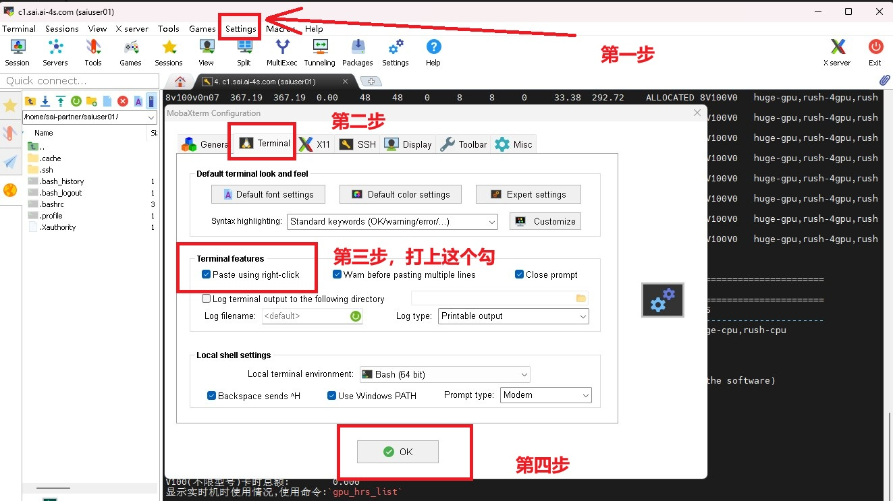
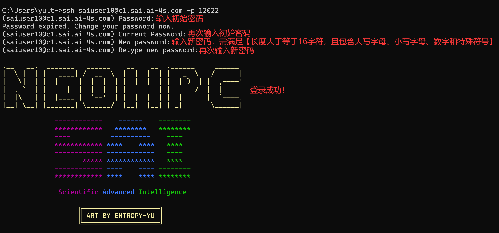
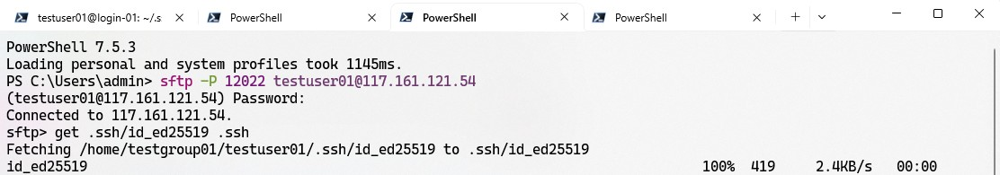
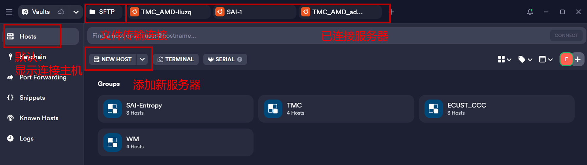
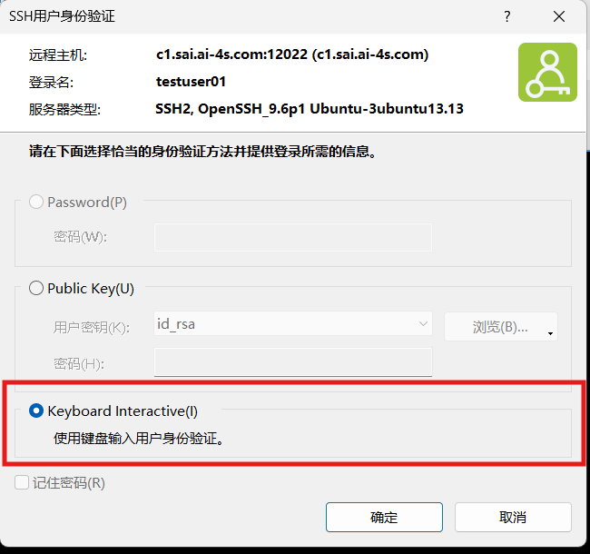
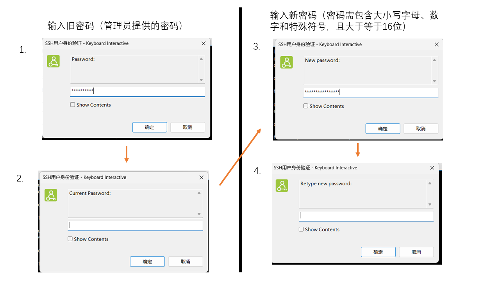

# 登录超算

## 登录节点

> **注意**
>
> 1.  登录节点是用户访问超算的窗口，不可直接运行计算任务
> 2.  登录节点仅用于任务提交/管理、软件安装、文件编辑、数据上传/下载等用途
>
> - 登录节点资源有限；需要较多 CPU 或内存的软件编译、数据处理，也请通过 Slurm 申请计算资源。
> - 若要进入计算节点进行交互式操作，可在sbatch任务开始运行后通过SSH进入任务分配的计算节点，或使用`srun`命令搭配`--pty bash`后缀，或使用`salloc`命令，[提交任务](https://vcnn7siwx4yx.feishu.cn/wiki/ZmkawnhNZicpxAkuwh4cNSWGnpc#QBQMdiT9wojo3WxVjoKcUjo0nSa)章节将详细介绍
>
> 1.  SAI的登录节点和计算节点均可直接访问互联网、直接下载文件

------------------------------------------------------------------------

## 登录信息

先在 [SAI 控制台](https://www.open-sai.com/portal/)确认账号已开通、站点已获准访问，并取得 SSH 用户名与登录密钥。昵称和 SSH 用户名可能不同。

**SAI 主站：**`c0.sai.ai-4s.com`，SSH 端口 `12022`。

登录后通过 Slurm 选择计算分区。卫星或姊妹集群使用各自的登录地址。

主站连接示例（将 `username` 换成 SSH 用户名）：

``` bash
ssh -p 12022 username@c0.sai.ai-4s.com
```

已领取私钥时，可加 `-i 私钥文件路径`；也可按下文配置 SSH 别名。

> 优先使用本人持有的登录密钥。新账号按通行证页面领取或管理密钥；旧账号仍能用密码登录时，可按下文下载自己已有的预置密钥。
>
> 如果服务器提示修改初始密码，`Current Password` 指当前密码。按屏幕要求设置新密码；输入时不显示字符是正常现象。
>
> 连续失败时先停止重试，核对地址、端口、用户名和凭据。仍无法登录，提供时间和报错向官方支持求助；不要发送密码或私钥。

------------------------------------------------------------------------

## 🔥 MobaXterm登录（📽️附视频）

> MobaXterm是常用的远程终端工具，可在此处下载：https://mobaxterm.mobatek.net/download.html

视频和截图展示 MobaXterm 的操作位置；连接时填上面的主站地址、自己的用户名和密钥。

<figure>
<a href="attachments/91c7fea2ca1d10d9268ae93c9603fbbeac76c723928de1689a74920bbe114ae2.bin" download="MobaXterm_login_v5.mp4">MobaXterm_login_v5.mp4</a>
</figure>

新建 SSH Session，填写主机、端口和用户名。勾选“Use private key”，选择自己的私钥文件：


> 防止旁观者或恶意程序窃取你的密码，输入密码时，字符通常不会显示在屏幕上。尽管你看不到输入的字符显示，但实际上密码已经被输入，只需在密码粘贴/输入完成后按下回车键即可。

### 在MobaXterm中复制粘贴

- 使用鼠标**拖动**或**双击**选中要复制的内容，即可**自动完成**复制
- 按下 \[**鼠标中键**\]（即滚轮按键,首选）或 \[Shift + Insert键\] 即可进行粘贴。也可使用鼠标右键来粘贴，通过以下方式设置：



------------------------------------------------------------------------

## 命令行登录（Windows、macOS、Linux）

Windows PowerShell、macOS 和 Linux 终端都可以使用下面的 OpenSSH 命令。若找不到 `ssh`，先安装本机的 OpenSSH 客户端。

在命令行中输入以下命令可SSH连接至SAI，请将`username`替换为实际的用户名。

``` bash
ssh -p 12022 username@c0.sai.ai-4s.com
```

> Windows 按 Win + R，输入 `powershell` 即可打开终端；安装了 PowerShell 7 的用户也可输入 `pwsh`。

输入上述命令进行SSH连接：



以下下载方式适用于仍能用密码登录、且已有预置密钥的账号。已经从通行证领取私钥的用户可直接配置 SSH，避免重复覆盖本地文件。

首先新开一个powershell窗口，使用以下命令SFTP连接至SAI，请将`username`替换为实际的用户名：

``` bash
sftp -P 12022 username@c0.sai.ai-4s.com
```

先在本机用户目录中建好 `.ssh` 文件夹。进入 SFTP 后用 `lpwd` 查看本地目录，必要时用 `lcd` 切换，再把私钥下载为 `.ssh/sai_ed25519`。已有同名文件时换个名字，避免覆盖。

``` bash
lpwd
get .ssh/id_ed25519 .ssh/sai_ed25519
```



私钥只供本人使用，不要发给别人。macOS/Linux 执行 `chmod 600 ~/.ssh/sai_ed25519` 限制读取权限；Windows 若提示权限过宽，在文件安全属性中仅保留本人访问。

用自己熟悉的编辑器打开用户目录中的 `.ssh/config`（没有扩展名）。Windows PowerShell 可以运行：

``` powershell
notepad "$env:USERPROFILE\.ssh\config"
```

macOS/Linux 可使用 `nano ~/.ssh/config`，前提是已安装 nano；也可使用 VS Code 等编辑器。编辑已有文件时保留原来的其他 Host 配置。

在文件末尾加入以下代码，请将`username`和`用户名`根据实际情况修改：

``` bash
Host SAI
  HostName c0.sai.ai-4s.com
  User username
  Port 12022
  IdentityFile ~/.ssh/sai_ed25519
```


对于`nano`，可使用Ctrl+X保存并退出。

顺利编辑后，在命令行中使用以下命令可使用密钥登录集群，无需再输入密码：

*PowerShell*

``` powershell
ssh SAI
```

如果遇到诡异报错，可以加上`-v`选项来获得更详细的输出，即：

*PowerShell*

``` powershell
ssh -v SAI
```

丢失私钥时，从通行证管理密钥或联系管理员恢复。不要直接覆盖集群里的 `~/.ssh/id_ed25519`，它还用于节点间互访。首次连接或主机指纹变化时，先向站点确认指纹。

------------------------------------------------------------------------

## Termius登录（For MacOS）

> Windows系统也可以用Termius，但更推荐MobaXTerm。Mac也可以用终端登录方法

Termius是一款跨平台的远程终端工具，可以在其官网下载：https://termius.com/

下载好并打开应该是如下界面。笔者这里有保存的服务器，新下载的应该是啥都没有的。



点击“NEW HOST”新建服务器连接，输入SAI服务器的相关信息即可。Termius能在初次登录时捕捉到SAI的初始密码和密码重置机制，并指引您进行密码重置。

------------------------------------------------------------------------

## Xshell登录（🚫不推荐）

> **不推荐**初次登录使用Xshell，**提示信息显示不全**

初次登录时需使用Keyboard Interactive：



随后根据屏幕上的提示，输入旧密码并设置新密码：



------------------------------------------------------------------------

## 💡FAQ

#### Q: 首次登录修改密码失败，提示“Old password not accepted”，如图：


> **A：**`Current Password` 要填当前密码；首次登录且尚未修改时，就是收到的初始密码。按提示完成当前密码、新密码和确认密码的输入；若本次失败，重新连接后再试。

------------------------------------------------------------------------

#### Q: 多次登录没有成功，之后就连不上了，这是为何？

> **A：**连续认证失败可能触发临时限制。请先停止反复重试，核对[登录超算](index.md)中的地址、端口和凭据配置，稍后再试。仍无法连接时，向管理员提供时间、客户端出口 IP 和报错。

#### Q: 网页能登录，为什么 SSH 还连不上？

> **A：**网页使用 SAI 账号登录；SSH 还需要该计算站点已开通，以及正确的 Linux 用户名和站点支持的登录凭据。先到控制台查看站点状态，再核对登录信息。

#### Q: 默认身份选了组织，在个人 Home 提交任务会记到哪里？

> **A：**没有通过命令、脚本或环境变量指定账户时，个人 Home 下的任务通常记到个人账户。作业工作目录的优先级高于默认身份；提交前查看账户设置和实际工作目录。
