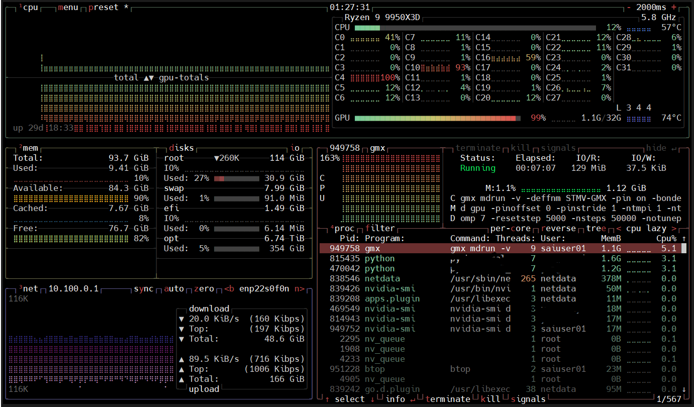

# 5分钟上手

先按[登录超算](../891ee584b71ab6f7b0d6d62d/index.md)连接登录节点。运行 `sai account local --format table`，选好本次计算的账户，并替换下面命令中的 `ACCOUNT`。任务开始运行后计费。

### 交互式命令行玩耍

用[任务提交和管理](../263082edffdfc401aebd0e23/index.md)中的 `srun` 进入计算节点玩耍。下面申请主站 4V100 的 1 张 GPU，最长 5 分钟；排到资源后会自动打开终端。

``` bash
srun --account=ACCOUNT --partition=4V100 --qos=rush-1o2gpu --nodes=1 --ntasks=1 --gpus-per-node=1 --time=00:05:00 --pty bash
```

看到命令提示符里的主机名变了，就已经进入计算节点。运行 `nvidia-smi` 看看自己的 GPU：

下图是八卡示例，这次单卡练习只需看自己分配到的 GPU。每张卡有独立显存，NVLink 负责加速卡间通信。


再试试 `nvidia-smi topo -m`，看看 GPU 和网卡怎样连接。下图是八卡节点的拓扑：


玩耍结束后，输入 `exit` 回到登录节点。再运行 `job`，确认这项交互任务已经结束。

------------------------------------------------------------------------

### 提交一个 GROMACS 示例

接下来用预先准备好的输入做一次 GROMACS 模拟。逐行执行下面的命令即可；`GMX-demo` 请使用一个尚不存在的目录名。先运行 10 分钟体验，达到时限后任务会停止。

``` bash
mkdir GMX-demo
cp /home/public/tutorial/GMX/* GMX-demo/
cd GMX-demo
cat gpu_gmx-singlegpu.sbatch
# 核对脚本后，将 ACCOUNT 替换为自己的 Slurm 账户名
sbatch --account=ACCOUNT --time=00:10:00 gpu_gmx-singlegpu.sbatch
sai jobs local --format table
```

记下 `sbatch` 返回的任务 ID。运行时用 `job` 看状态，结束后看 `slurm-JOB_ID.out` 和 `STMV-GMX.log`；`sacct -X -j JOB_ID -o JobID,State,ExitCode,Elapsed` 可查结束原因。想提前停下就用 `scancel JOB_ID`，关闭 SSH 窗口不会取消批处理任务。


